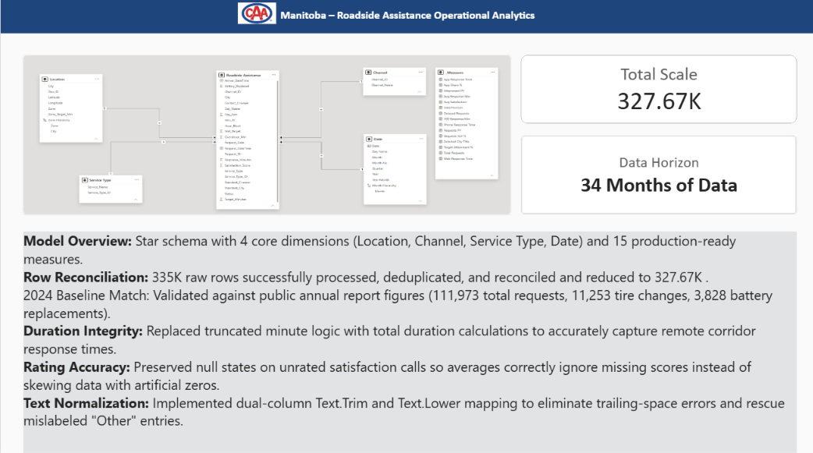

# CAA Manitoba - Roadside Assistance Operational Analytics

An enterprise-grade, 4-page Power BI business intelligence and operational analytics platform designed to monitor roadside assistance performance, spatial distribution, channel adoption, and service-level agreement (SLA) target attainment across Manitoba over a 34-month horizon.

---

## 📊 Executive Summary & Key Metrics

This solution processes **335K raw operational records**, successfully deduplicating, reconciling, and refining them down to **327.67K production rows**. The data model establishes a verified baseline against public annual reports (matching 111,973 total requests, 11,253 tire changes, and 3,828 battery replacements for 2024).

* **Total Request Volume:** ~328K requests across a 34-month window (YoY Growth: +59.83%)
* **Target Attainment SLA:** 90.29% overall compliance
* **Average Customer Satisfaction (CSAT):** 4.41 / 5.00
* **Average Response Time:** 33.39 minutes

---

## 🏗️ Data Architecture & Star Schema

The solution is built on a high-performance **Star Schema** optimized for DAX calculation performance and fast slicing across geographical and categorical hierarchies.


* **Fact Table:** `Roadside Assistance` (~327.67K rows) capturing transactional timestamps, channel metadata, geographic coordinates, service durations, and customer ratings.
* **Dimension Tables:** `Location` (urban/regional hierarchy), `Channel` (digital app, web, phone, other), `Service Type` (towing, battery, lockout, flat tire, fuel), and `Date` (comprehensive calendar dimension).
* **Measures:** 15 production-ready DAX measures engineered for dynamic filtering, YoY comparisons, and SLA target tracking.

---

## 🛠️ Data Engineering & ETL Highlights (Power Query)

To guarantee analytical integrity, several complex data quality challenges were resolved during the ETL pipeline development:

1. **Row Reconciliation:** Processed 335K raw records down to 327.67K through rigorous duplicate detection and invalid key elimination.
2. **Duration Integrity Overhaul:** Replaced flawed, truncated minute logic with precise total-duration calculations to accurately capture extended response times across remote northern corridors.
3. **Rating Accuracy & Null Handling:** Preserved `NULL` states on unrated satisfaction interactions so that calculated averages correctly ignore missing scores rather than dragging down performance with artificial zeros.
4. **Text Normalization:** Implemented dual-column `Text.Trim` and `Text.Lower` mapping via Power Query to eradicate trailing-space inconsistencies and safely rescue mislabeled "Other" category entries.

---

## 📱 Dashboard Pages & Preview

### 1. Architecture Overview
Technical layout displaying the star schema architecture with 4 core dimensions (`Location`, `Channel`, `Service Type`, `Date`), 15 production-ready measures, row reconciliation metrics, and data cleansing logic.



### 2. Executive Overview
Global high-level KPIs (`328K Total Requests`, `59.83% YoY Growth`, `4.41 Avg Satisfaction`, `90.29% Target Attainment`, `33.39 Avg Response Min`), global/regional slicers, hourly delay distributions, an interactive geographic coordinate map of Manitoba, and regional target attainment rankings.


### 3. Channel & Experience
Longitudinal tracking of digital channel adoption (`App Share % by Year-Month` climbing from ~28% to over 44%), absolute volume distributions across roadside service categories, and channel-specific customer satisfaction metrics (`Avg Satisfaction by Channel_Name` led by App at 4.59).


### 4. City Deep-Dive
Localized single-city performance analysis (such as Selkirk) featuring municipal volume metrics (`11K Total Requests`, `91.70% Target Attainment`, `30.68 Avg Response Min`), a comprehensive day-of-week by hour-block congestion matrix, historical trends, and specific service-type distributions for the region.


---

## 🚀 Tech Stack & Tools

* **Data Modeling & Visualization:** Power BI Desktop, Power Query (M)
* **Data Transformation & Cleansing:** Python / SQL (supporting backend pipelines)
* **Version Control:** Git & GitHub

---

## 📁 Repository Structure

```text
CAA-Manitoba-Roadside-Assistance-Analytics/
│
├── assets/                  # Dashboard screenshots and UI preview images
│   ├── Overview.png
│   ├── Executive Overview Page.png
│   ├── Channel Overview Page.png
│   ├── City Drill Down.png
│   └── Star Schema.png
├── data/                    # Raw monthly CSVs (2024-2026), dimension tables, and JSON targets
├── power_bi/                # CAA_Manitoba_Roadside_Assistance.pbix
└── README.md                # Project documentation